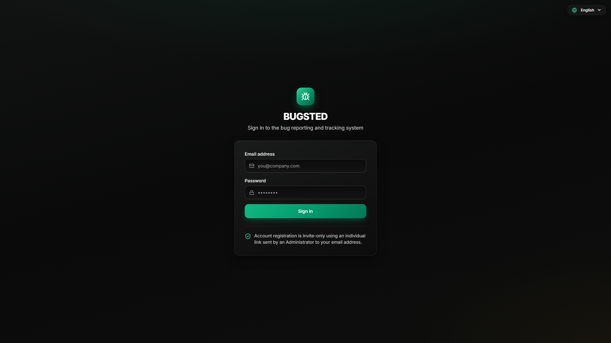
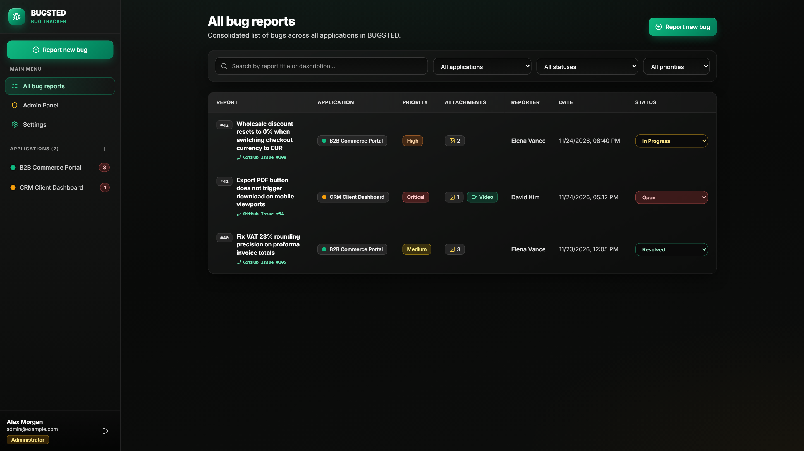
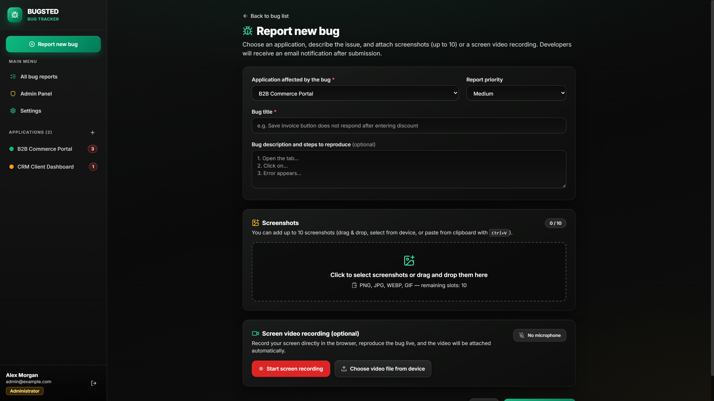
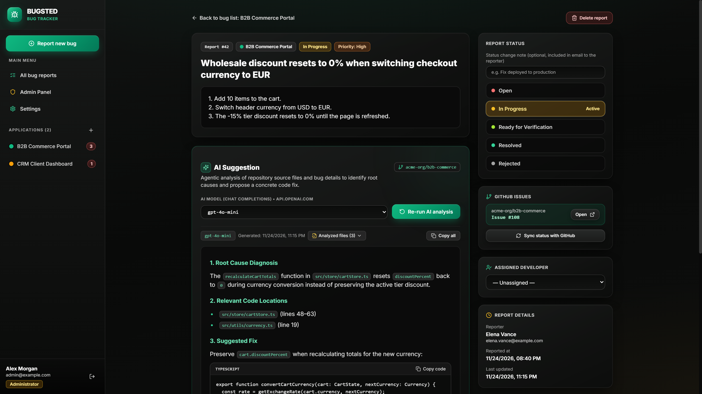
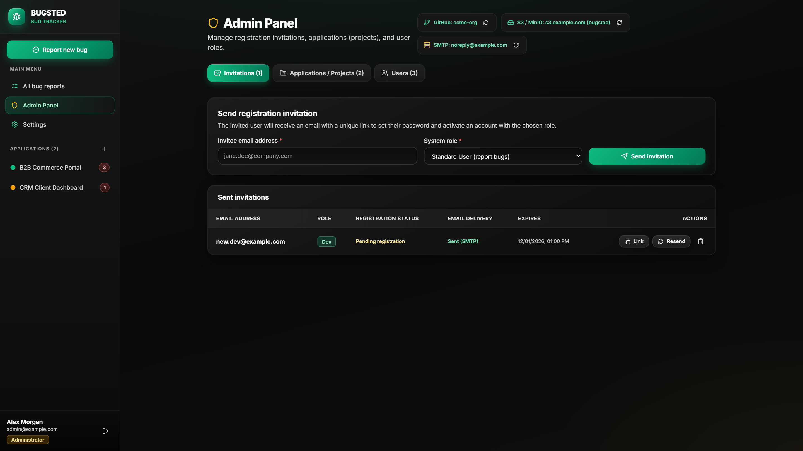
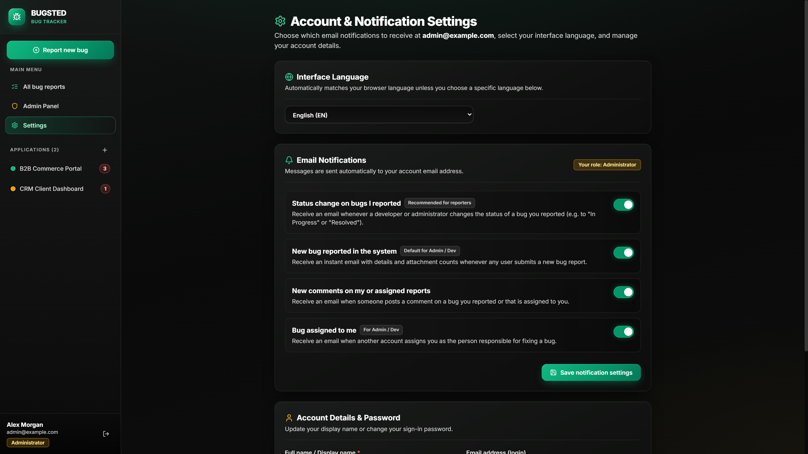

# BUGSTED — User Guide

Welcome to **[BUGSTED](https://github.com/arturwyroslak/BUGSTED)**! This guide walks through everyday workflows for team members, developers, and administrators.

---

## Table of Contents

1. [Signing In & Account Activation](#1-signing-in--account-activation)
2. [Roles & Permissions](#2-roles--permissions)
3. [Browsing & Filtering Bug Reports](#3-browsing--filtering-bug-reports)
4. [Reporting a New Bug](#4-reporting-a-new-bug)
5. [Working Inside a Bug Report & Running AI Suggestions](#5-working-inside-a-bug-report--running-ai-suggestions)
6. [Two-Way GitHub Issues Sync](#6-two-way-github-issues-sync)
7. [Admin Panel (Invitations, Applications & User Roles)](#7-admin-panel-invitations-applications--user-roles)
8. [Account Settings, Interface Language & Email Notifications](#8-account-settings-interface-language--email-notifications)

---

## 1. Signing In & Account Activation

BUGSTED uses **invite-only registration** so unauthorized users cannot create accounts on a public instance.

1. Open your BUGSTED URL.
2. Enter your email address and password on the sign-in screen.
3. Need another language before signing in? Use the **language selector** in the top-right corner (`English`, `Polski`, `Español`, `Deutsch`, `Français`, `العربية`, `中文`).

### Activating an Invited Account
If an Administrator invited you:
1. Click the unique registration link in your invitation email (or shared by your Administrator).
2. Verify your email and assigned role on the activation card.
3. Enter your display name and choose a password (at least 6 characters), then click **Create account and sign in**.

---

## 2. Roles & Permissions

| Role | What They Can Do |
|---|---|
| **Standard User** | Report bugs, attach screenshots/screen recordings, view all applications and bug reports, post comments, manage personal notification and language settings. |
| **Developer (Dev)** | Everything a Standard User can do, plus: change bug statuses, assign developers to bugs, trigger/export GitHub Issue syncs, and run AI Suggestions. Receives new-bug emails by default. |
| **Administrator** | Full permissions: invite users, change any user's role, delete accounts or bug reports, create/edit/delete applications (projects), configure GitHub repositories, and check GitHub / S3 / SMTP health. |

---

## 3. Browsing & Filtering Bug Reports

After signing in, you land on **All bug reports** — a unified list across every application in BUGSTED.

- **Search & Filter:** Filter bugs by keyword (title or description), application, status (`Open`, `In Progress`, `Ready for Verification`, `Resolved`, `Rejected`), or priority (`Low`, `Medium`, `High`, `Critical`).
- **Application Dashboards:** Click any application in the left sidebar (next to its open bug count badge) to open that project's dedicated view with clickable status KPI cards (`All`, `Open`, `In Progress`, `In Verification`, `Resolved`).
- **Quick Status Updates:** Administrators and Developers can update statuses directly from the dropdown in the bug table without even opening the ticket.

---

## 4. Reporting a New Bug

Click **Report new bug** in the top-left sidebar (or **Report bug in this app** from an application dashboard).

### Steps to Submit a Bug
1. **Select Application & Priority:** Choose the affected application and set the severity (`Low`, `Medium`, `High`, or `Critical`).
2. **Write Title & Steps to Reproduce:** Provide a concise title and optional step-by-step reproduction notes.
3. **Attach Screenshots (up to 10):**
   - Click the dropzone to select images (`PNG`, `JPG`, `WEBP`, `GIF`),
   - Drag and drop files directly onto the dropzone, or
   - Take a screenshot anywhere on your computer and press **`Ctrl+V`** anywhere on the page to paste it straight from your clipboard!
4. **Attach a Screen Video Recording (Optional):**
   - Click **Start screen recording** to capture a browser tab, window, or full screen directly inside your browser (toggle **Microphone on / No microphone** beforehand if you want voice narration).
   - You can **Pause / Resume**, preview the recording right on the form, re-record, or upload an existing `.webm` / `.mp4` video file from your device.
5. Click **Submit bug report**. All screenshots and video are streamed directly to S3/MinIO storage, a GitHub Issue is created automatically if sync is enabled on that project, and subscribed Developers/Admins receive an email notification.

---

## 5. Working Inside a Bug Report & Running AI Suggestions

Click any bug title to open its detail view.

Inside a bug report, you can:
- **Inspect Media:** Play the attached screen recording directly (with full seeking support) or click any screenshot thumbnail to open the fullscreen lightbox viewer (supports arrow keys and `Esc`).
- **Update Status & Add Status Note (Admin / Dev):** Add an optional note (e.g., *"Fix deployed to production"*) and click any status button. The bug's original reporter is notified automatically by email if their notifications are enabled.
- **Assign Developer (Admin / Dev):** Pick the developer responsible for the bug from the right-hand **Assigned developer** dropdown.
- **Collaborate via Comments:** Post updates in **Activity & comments**, where status changes and comments appear in chronological order.

### Using AI Suggestion
Every bug report includes the **AI Suggestion** card:
1. Select a configured model from the **AI Model (Chat Completions)** dropdown — or pick **Custom model ID...** to type another model identifier supported by your configured endpoint.
2. Click **Run AI analysis** (or **Re-run AI analysis** to refresh an existing report).
3. Watch **AI agent live progress** stream in real time as the agent fetches the repository file tree (when a GitHub repository is linked to the application), reads relevant source files, and diagnoses the bug.
4. Once finished, BUGSTED displays:
   - The list of **Analyzed files**,
   - A structured root-cause breakdown and suggested code fix in your active UI language,
   - One-click **Copy all** and **Copy code** buttons on every code block.

---

## 6. Two-Way GitHub Issues Sync

When an application has a GitHub repository linked and **Sync bugs with GitHub Issues (two-way)** enabled:
- Submitting a new bug in BUGSTED automatically opens a corresponding GitHub Issue and displays a `GH #<number>` badge linking straight to GitHub.
- Marking a bug as `Resolved` or `Rejected` in BUGSTED automatically closes the GitHub Issue; moving it back to `Open`, `In Progress`, or `Ready for Verification` reopens it.
- Closing or reopening the Issue directly on GitHub updates the status in BUGSTED automatically via webhook (or on demand via the **Sync status with GitHub** button).
- Older bugs created before GitHub sync was enabled show a **Create Issue on GitHub** button for Admin/Dev users so you can link them at any time.

---

## 7. Admin Panel (Invitations, Applications & User Roles)

Administrators can open **Admin Panel** from the main sidebar to check system health (`GitHub`, `S3 / MinIO`, `SMTP`) and manage the workspace across three tabs:

1. **Invitations:**
   - Enter an email address, select the role (`Standard User`, `Developer / Dev`, or `Administrator`), and click **Send invitation**.
   - If SMTP is configured, the invite email is delivered automatically; you can also copy the invitation link anytime with **Link** / **Copy link** or click **Resend**.
2. **Applications / Projects:**
   - Add, edit, or delete tracked applications, customize their badge color and URL, pick a GitHub repository from the searchable picker (for **AI Suggestion**), and toggle two-way **GitHub Issues** synchronization.
3. **Users:**
   - View every registered user, check their active email notification preferences, report count, and **change any user's role** live via the role dropdown. (BUGSTED protects the last remaining Administrator from being demoted.)

---

## 8. Account Settings, Interface Language & Email Notifications

Open **Settings** from the left sidebar to personalize your workspace:

- **Interface Language:**
  - By default, BUGSTED matches your browser's language automatically (`Auto-detect from browser`).
  - You can explicitly switch between **English**, **Polski**, **Español**, **Deutsch**, **Français**, **العربية** (automatically switches layout to right-to-left `RTL`), and **中文**. Your preference is saved to your account across devices.
- **Email Notifications:**
  - Independently toggle emails for:
    - **Status change on bugs I reported** *(enabled by default for all users)*
    - **New bug reported in the system** *(enabled by default for Admin / Dev)*
    - **New comments on my or assigned reports**
    - **Bug assigned to me** *(visible for Admin / Dev)*
- **Account Details & Password:**
  - Update your display name or change your password at any time.

---

For server installation and environment configuration, see the **[Self-Hosting & Deployment Guide](DEPLOYMENT.md)**.
